<!-- ═════════════════════════ HEADER ═════════════════════════ -->

  

  

  
  
  

  
  

<!-- ═════════════════════════ IMPACT ═════════════════════════ -->
<h2 align="center">📊 Impact at a Glance</h2>

<table>
  <tr>
    <td align="center" width="180"><h2>99.9%</h2><b>Uptime</b> at $0 hosting cost <i>EcoQuest</i></td>
    <td align="center" width="180"><h2>↓ 90%</h2><b>Deployment downtime</b> 20 min → under 2 min on EC2</td>
    <td align="center" width="180"><h2>↓ 40%</h2><b>Database read latency</b> MongoDB indexing + caching</td>
    <td align="center" width="180"><h2>10+ hrs</h2><b>Saved every week</b> Airflow ETL automation</td>
  </tr>
</table>

<!-- ═════════════════════════ ABOUT ═════════════════════════ -->
## 👨‍💻 About Me

  

  <b>I turn code into reliable, secure production systems.</b> 
  I work across the whole path to production: I write the backend, build the pipeline that ships it, run it on AWS, and set up the monitoring and security that keep it healthy. Then I measure the result and make it faster.

<h3 align="center">⚙️ What I Do</h3>

<table>
  <tr>
    <td width="33%" align="center" valign="top">
       
      <h4>🏗️ Build</h4>
      Full-stack apps, REST APIs and real-time WebSocket engines handling <b>50+ live sessions</b>
    </td>
    <td width="33%" align="center" valign="top">
       
      <h4>🔁 Ship</h4>
      CI/CD pipelines and zero-downtime releases that cut deploy downtime <b>from 20 min to under 2</b>
    </td>
    <td width="33%" align="center" valign="top">
       
      <h4>☁️ Run</h4>
      AWS EC2, S3, IAM, VPC and RDS, with Linux process management and Bash automation
    </td>
  </tr>
  <tr>
    <td width="33%" align="center" valign="top">
       
      <h4>🔄 Automate</h4>
      Airflow ETL pipelines and Go ingestion services that <b>save 10+ hours a week</b>
    </td>
    <td width="33%" align="center" valign="top">
        
      <h4>🛡️ Secure &amp; Observe</h4>
      JWT, RBAC, rate limiting and IAM policies, plus Grafana alerting and Wazuh SIEM
    </td>
    <td width="33%" align="center" valign="top">
       
      <h4>🤖 Extend with AI</h4>
      Claude-powered personalization with safety filtering, plus GenAI and RAG fundamentals
    </td>
  </tr>
</table>

<table>
  <tr>
    <td>🔭 <b>Currently exploring</b></td>
    <td>Machine Learning, Computer Vision and Generative AI (RAG)</td>
  </tr>
  <tr>
    <td>💬 <b>Ask me about</b></td>
    <td>CI/CD pipelines · Django &amp; Node.js backends · AWS · SIEM monitoring</td>
  </tr>
  <tr>
    <td>🎯 <b>Looking for</b></td>
    <td>DevOps, Cloud, Platform and Security engineering roles</td>
  </tr>
  <tr>
    <td>⚡ <b>Motto</b></td>
    <td><i>"Secure by design, scalable by default."</i></td>
  </tr>
</table>

<!-- ═════════════════════════ SKILLS ═════════════════════════ -->
## 🧰 Tech Stack

<table>
  <tr>
    <td width="200"><b>💻 Languages</b></td>
    <td></td>
  </tr>
  <tr>
    <td><b>⚙️ Backend</b></td>
    <td> Django REST Framework · RESTful APIs · WebSockets (Socket.io)</td>
  </tr>
  <tr>
    <td><b>🎨 Frontend</b></td>
    <td> React 18 · Zustand · Progressive Web Apps</td>
  </tr>
  <tr>
    <td><b>☁️ Cloud & DevOps</b></td>
    <td> AWS EC2 · S3 · IAM · VPC · RDS · Linux process management</td>
  </tr>
  <tr>
    <td><b>🗄️ Data & Orchestration</b></td>
    <td>  ETL pipelines · MongoDB Atlas · Hadoop / Spark (exposure)</td>
  </tr>
  <tr>
    <td><b>🛡️ Security & Observability</b></td>
    <td>  JWT auth · RBAC · rate limiting · Helmet · CORS · IAM policies</td>
  </tr>
  <tr>
    <td><b>🤖 AI / ML</b></td>
    <td>  Supervised & unsupervised learning · model evaluation metrics</td>
  </tr>
</table>

<!-- ═════════════════════════ PROJECTS ═════════════════════════ -->
## 🚀 Featured Projects

### 🤖 AutoSWE: Autonomous AI Software Engineering Platform
     

- **Five-agent LLM pipeline** (analyst → architect → coder → DevOps → reviewer) turns a plain-English spec into a downloadable project: FastAPI code and tests, Dockerfile, CI workflow, Kubernetes manifests and Terraform
- Every generated file is **parsed and policy-checked** (paths, secrets, K8s/Docker/CI rules) with an automatic repair pass; generated Terraform and manifests pass `terraform validate` and `kubeconform -strict` in CI
- Async jobs with persisted progress **streamed live over SSE** to a React dashboard; pluggable providers (Claude + a deterministic offline provider so CI runs without API keys)
- 📂 Code: [Autonomous-AI-Software-Engineering-Platform](https://github.com/Arya-9989/Autonomous-AI-Software-Engineering-Platform)

### 🎮 EcoQuest Platform
    

- Serverless full-stack platform for 3 user roles, reaching **99.9% uptime at zero hosting cost** (Vercel + Render + MongoDB Atlas)
- Real-time Socket.io engine that keeps **50+ live multiplayer game states** in sync with sub-second latency
- **40% lower database read latency** from compound MongoDB indexes and tiered Node-cache TTLs
- **10+ API endpoints with zero vulnerabilities** in simulated payload attacks (JWT/RBAC middleware, rate limiting, strict CORS)
- Claude Haiku engine adapts learning paths across 3 performance tiers, behind a two-layer topic-safety filter

### ⚡ High-Throughput Analytics Engine
   

- Go microservice ingesting **thousands of tracking events per minute with zero data loss**, using PostgreSQL connection pooling
- Fully containerized with Docker, which **eliminated environment drift** for new developers
- Airflow DAGs turn raw logs into query-optimized data marts, **saving 10+ hours of manual reporting every week**

### 🏢 Multi-Tenant Microservices Architecture
    

- B2B Django backend with **100% organization-level data isolation** through query-scoped ORM filtering and strict permission classes
- Declarative **Jenkins CI/CD pipelines** triggered by GitHub webhooks for continuous delivery to staging
- Bash process-management scripts for seamless service swaps on EC2: **deployment downtime cut by 90%**
- 📂 Code: [secure-multi-tenant-platform](https://github.com/Arya-9989/secure-multi-tenant-platform): fail-closed tenant isolation, RBAC, expiring invitations and an append-only audit log, with a **228-test suite that attacks every endpoint cross-tenant**
- 📂 Code: [secure-cloud-microservices-platform](https://github.com/Arya-9989/secure-cloud-microservices-platform): Django auth service issuing JWTs via JWKS + **Java 21 Spring Boot** orders service behind a Traefik gateway, with Prometheus/Grafana, Trivy-scanned images and a 26-test end-to-end suite in CI

### 🛡️ Infrastructure Observability & SIEM Platform
  

- Centralized **Grafana monitoring with threshold-based alerting** across virtualized Linux hosts
- **Wazuh SIEM auditing 100% of critical file-integrity events** and unauthorized access attempts, with real-time anomaly detection

### 🛒 Scalable E-Commerce API Backend
  

- Order workflows, stateful cart management and secure user authentication
- **30% lower read/write latency** on dynamic product catalogs through data modeling and Django ORM query optimization
- 📂 Code: [SecureCart](https://github.com/Arya-9989/SecureCart-Cloud-Native-Security-Enhanced-eCommerce-Platform): Django REST + React/TypeScript storefront and admin console with rotating httpOnly refresh tokens and a **row-locked checkout that can't oversell** (proven by a concurrent-buyers test)

<!-- ═════════════════════════ REPOS ═════════════════════════ -->
## 📂 Open-Source Repositories

  
  
  
  

<b>🔬 More projects & research</b>

 

| Project | What it is |
| :-- | :-- |
| 📈 **[Momentum Live Stock Tracker](https://github.com/Arya-9989/Momentum-Live-Stock-Tracker)** | Global stocks, indices, FX and crypto dashboard with candlesticks, tested technical indicators (SMA/EMA/RSI/MACD/Bollinger), comparison and watchlist (Streamlit · Plotly · yFinance) |
| 🗄️ **Secure Evidence Archiving & Retrieval System** | Tamper-proof digital forensic evidence storage with encryption and audit trails |
| 🦠 **Ransomware Detection Tool** | Behavior-based detection of encryption malware using anomaly detection |
| 🧬 **Quantum-Resistant Cloud Encryption** | IEEE-style research paper on post-quantum cryptography for cloud data |
| ❄️ **Cooling Solutions for Data Centers** | IEEE-style research paper |

<!-- ═════════════════════════ EDUCATION ═════════════════════════ -->
## 🎓 Education & Certification

<table>
  <tr>
    <td width="50%" valign="top">
      <h3>🎓 B.Tech, Cloud Technology & Information Security</h3>
      <b>Ajeenkya D Y Patil University, Pune</b> · 2022 – 2026  
      Cloud Computing · Network Security · Information Security · Operating Systems · DBMS · Software Engineering · Data Structures & Algorithms
    </td>
    <td width="50%" valign="top">
      <h3>🏅 AWS Certified Cloud Practitioner</h3>
      <b>Amazon Web Services</b> · Apr 2026 – Apr 2029  
      EC2 · S3 · IAM · VPC networking · security groups · load balancing · cloud deployment best practices
    </td>
  </tr>
</table>

<!-- ═════════════════════════ CONTACT ═════════════════════════ -->
## 🤝 Let's Work Together

  I'm looking for <b>DevOps, Cloud, Platform and Security engineering</b> roles. 
  If your team ships to the cloud and cares about doing it securely, I'd love to talk.

  
  
  <!-- Add LinkedIn: replace YOUR-HANDLE and uncomment
  
  -->

  

