
<picture><source media="(prefers-color-scheme: dark)" srcset="assets/hero-dark.svg"></picture>

<a href="mailto:arya.mahindrakar.09@gmail.com"><picture><source media="(prefers-color-scheme: dark)" srcset="assets/cta-email-dark.svg"></picture></a><a href="https://github.com/Arya-9989?tab=repositories"><picture><source media="(prefers-color-scheme: dark)" srcset="assets/cta-repos-dark.svg"></picture></a>

<!-- About -->

<h2 align="center"><picture><source media="(prefers-color-scheme: dark)" srcset="assets/h-about-dark.svg"></picture></h2>

I work across the whole path to production: I write the backend, build the pipeline that ships it, run it on AWS, and set up the monitoring and security that keep it healthy. Then I measure the result and make it faster.

<h3 align="center"><picture><source media="(prefers-color-scheme: dark)" srcset="assets/h-what-dark.svg"></picture></h3>

<picture><source media="(prefers-color-scheme: dark)" srcset="assets/cap-1-dark.svg"></picture><picture><source media="(prefers-color-scheme: dark)" srcset="assets/cap-2-dark.svg"></picture><picture><source media="(prefers-color-scheme: dark)" srcset="assets/cap-3-dark.svg"></picture><picture><source media="(prefers-color-scheme: dark)" srcset="assets/cap-4-dark.svg">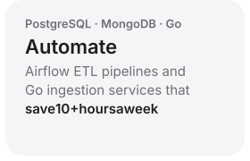</picture><picture><source media="(prefers-color-scheme: dark)" srcset="assets/cap-5-dark.svg"></picture><picture><source media="(prefers-color-scheme: dark)" srcset="assets/cap-6-dark.svg"></picture><picture><source media="(prefers-color-scheme: dark)" srcset="assets/cap-7-dark.svg"></picture><picture><source media="(prefers-color-scheme: dark)" srcset="assets/cap-8-dark.svg"></picture><picture><source media="(prefers-color-scheme: dark)" srcset="assets/cap-9-dark.svg"></picture><picture><source media="(prefers-color-scheme: dark)" srcset="assets/cap-10-dark.svg"></picture>

<!-- Impact -->

<h2 align="center"><picture><source media="(prefers-color-scheme: dark)" srcset="assets/h-impact-dark.svg"></picture></h2>

<picture><source media="(prefers-color-scheme: dark)" srcset="assets/impact-1-dark.svg">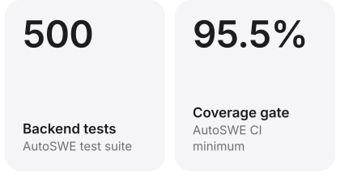</picture><picture><source media="(prefers-color-scheme: dark)" srcset="assets/impact-2-dark.svg">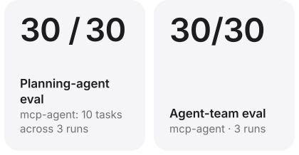</picture>

<!-- Tech stack -->

<h2 align="center"><picture><source media="(prefers-color-scheme: dark)" srcset="assets/h-stack-dark.svg"></picture></h2>

<picture><source media="(prefers-color-scheme: dark)" srcset="assets/stack-1-dark.svg"></picture><picture><source media="(prefers-color-scheme: dark)" srcset="assets/stack-2-dark.svg"></picture><picture><source media="(prefers-color-scheme: dark)" srcset="assets/stack-3-dark.svg"></picture><picture><source media="(prefers-color-scheme: dark)" srcset="assets/stack-4-dark.svg"></picture><picture><source media="(prefers-color-scheme: dark)" srcset="assets/stack-5-dark.svg"></picture><picture><source media="(prefers-color-scheme: dark)" srcset="assets/stack-6-dark.svg"></picture><picture><source media="(prefers-color-scheme: dark)" srcset="assets/stack-7-dark.svg">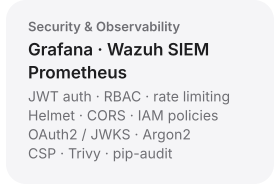</picture><picture><source media="(prefers-color-scheme: dark)" srcset="assets/stack-8-dark.svg">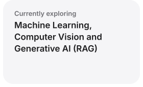</picture><picture><source media="(prefers-color-scheme: dark)" srcset="assets/stack-9-dark.svg"></picture><picture><source media="(prefers-color-scheme: dark)" srcset="assets/stack-10-dark.svg"></picture><picture><source media="(prefers-color-scheme: dark)" srcset="assets/stack-11-dark.svg"></picture><picture><source media="(prefers-color-scheme: dark)" srcset="assets/stack-12-dark.svg">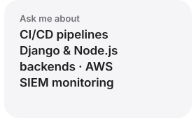</picture>

<!-- Open-source repositories -->

<h2 align="center"><picture><source media="(prefers-color-scheme: dark)" srcset="assets/h-repos-dark.svg"></picture></h2>

<a href="https://github.com/Arya-9989/Autonomous-AI-Software-Engineering-Platform"><picture><source media="(prefers-color-scheme: dark)" srcset="assets/repo-autoswe-dark.svg"></picture></a><a href="https://github.com/Arya-9989/Autonomous-AI-Software-Engineering-Platform"><picture><source media="(prefers-color-scheme: dark)" srcset="assets/repo-autoswe-flow-dark.svg"></picture></a><a href="https://github.com/Arya-9989/SecureCart-Cloud-Native-Security-Enhanced-eCommerce-Platform"><picture><source media="(prefers-color-scheme: dark)" srcset="assets/repo-securecart-dark.svg"></picture></a><a href="https://github.com/Arya-9989/secure-cloud-microservices-platform"><picture><source media="(prefers-color-scheme: dark)" srcset="assets/repo-microservices-dark.svg"></picture></a><a href="https://github.com/Arya-9989/secure-multi-tenant-platform"><picture><source media="(prefers-color-scheme: dark)" srcset="assets/repo-multitenant-dark.svg"></picture></a><a href="https://github.com/Arya-9989/Momentum-Live-Stock-Tracker"><picture><source media="(prefers-color-scheme: dark)" srcset="assets/repo-momentum-dark.svg"></picture></a>

<!-- Featured projects -->

<h2 align="center"><picture><source media="(prefers-color-scheme: dark)" srcset="assets/h-projects-dark.svg"></picture></h2>

### AutoSWE: Autonomous AI Software Engineering Platform
*Flagship AI project · Python · FastAPI · React · Claude AI · OpenTelemetry · Kubernetes*

- **Five typed agent stages** (analyst → architect → coder → DevOps → reviewer), each producing a Pydantic artifact, turn a plain-English spec into a downloadable project in **Python, TypeScript or Go**: code and tests, migrations, Dockerfile, CI workflow, Kubernetes manifests and Terraform
- Generated test suites run in a **locked-down sandbox** (no network, read-only, capped memory and processes) and failures feed a bounded **repair loop**; every file is also parsed and policy-checked
- **Eval harness with regression gates in CI**, per-user **token budgets** with cost reporting, and **OpenTelemetry traces** of every agent stage and model call
- Async jobs with persisted progress **streamed live over SSE** to a React dashboard; pluggable providers (Claude + a deterministic offline provider so CI runs without API keys)
- Code: [Autonomous-AI-Software-Engineering-Platform](https://github.com/Arya-9989/Autonomous-AI-Software-Engineering-Platform)
- Proof: **95.5% minimum coverage**, enforced by the repository's CI configuration.

### EcoQuest Platform
*Python · Django · PostgreSQL · Django templates · Bootstrap · JavaScript · Docker · GitHub Actions*

- **Gamified environmental learning with teacher-scoped classrooms**: student, teacher and admin portals, approval-gated authoring, and class-scoped analytics and CSV exports backed by cross-teacher isolation tests
- **Server-enforced quiz integrity** through randomized question-bank draws, persisted question and choice order, deadline checks and idempotent grading that makes replayed submissions a no-op
- **A transaction-protected rewards economy** with XP, coins, streaks, badges, daily challenges and leaderboards; improvement-only quiz XP prevents retake farming, while row locks protect against duplicate rewards and shop double-spending, covered by PostgreSQL concurrency tests
- **Retryable background email** through a database outbox with idempotent enqueueing, worker leases, crash recovery and exponential backoff; SMTP integration and concurrent-worker tests are wired into CI
- **Security and deployment checks built into CI**: nonce-based CSP and secure HTTPS defaults, PostgreSQL tests, lint and type checks, and a non-root Docker image with container health and static-asset smoke tests
- Proof: **448 tests** (private repository).

### mcp-agent: Inspectable Agent Runtime
*Python · MCP · LangGraph · OpenAI-compatible APIs*

- **Planning agent and manager–worker team** share MCP tools, with bounded execution and schema-checked tool arguments
- **30/30 task success for each agent over three runs** on the recorded 10-request eval set; results measured on 29 October 2026
- **Traced model and tool calls**, persistent memory and reproducible eval scripts make runtime behavior inspectable

### Multi-Tenant Microservices Architecture
*Python · Django REST · AWS EC2 · Jenkins · Docker*

- B2B Django backend with **100% organization-level data isolation** through query-scoped ORM filtering and strict permission classes
- Declarative **Jenkins CI/CD pipelines** triggered by GitHub webhooks for continuous delivery to staging
- **OpenTelemetry tracing** and signed-image verification in the cloud microservices platform
- Code: [secure-multi-tenant-platform](https://github.com/Arya-9989/secure-multi-tenant-platform): fail-closed tenant isolation enforced twice (ORM scoping and **PostgreSQL row-level security**), MFA and OIDC SSO, and a hash-chained audit log, with a **663-test suite that attacks every endpoint cross-tenant**
- Code: [secure-cloud-microservices-platform](https://github.com/Arya-9989/secure-cloud-microservices-platform): Django auth service issuing JWTs via JWKS + **Java 21 Spring Boot** orders service behind a Traefik gateway, with OpenTelemetry tracing, DPoP service tokens, **cosign-signed images verified at admission**, k6 latency SLOs and a 55-test end-to-end suite in CI

### Infrastructure Observability & SIEM Platform
*Grafana · Wazuh SIEM · Linux*

- Centralized **Grafana monitoring with threshold-based alerting** across virtualized Linux hosts
- **Wazuh SIEM file-integrity and unauthorized-access monitoring**, with real-time anomaly detection

### Scalable E-Commerce API Backend
*Django · Python · SQL*

- Order workflows, stateful cart management and secure user authentication
- **30% lower read/write latency** on dynamic product catalogs through data modeling and Django ORM query optimization
- Code: [SecureCart](https://github.com/Arya-9989/SecureCart-Cloud-Native-Security-Enhanced-eCommerce-Platform): Django REST + React/TypeScript storefront and admin console with rotating httpOnly refresh tokens, signature-verified **Stripe webhooks** and a **row-locked checkout that can't oversell** (proven by a concurrent-buyers test)

<b>More projects & research</b>

 

| Project | What it is |
| :-- | :-- |
| **[Momentum Live Stock Tracker](https://github.com/Arya-9989/Momentum-Live-Stock-Tracker)** | Global stocks, indices, FX and crypto dashboard with tested technical indicators (SMA/EMA/RSI/MACD/Bollinger), price alerts, a FIFO portfolio and saved watchlists (Streamlit · Lightweight Charts · yFinance) |
| **[AutoSWE eval harness](https://github.com/Arya-9989/Autonomous-AI-Software-Engineering-Platform)** | Recorded-response evals with CI regression gates across Python, TypeScript and Go |
| **[mcp-agent](https://github.com/Arya-9989/mcp-agent)** | Planning and team agents over MCP, with persistent memory and reproducible task evals |
| **Quantum-Resistant Cloud Encryption** | IEEE-style research paper on post-quantum cryptography for cloud data |
| **Cooling Solutions for Data Centers** | IEEE-style research paper |

<!-- Education -->

<h2 align="center"><picture><source media="(prefers-color-scheme: dark)" srcset="assets/h-edu-dark.svg"></picture></h2>

<picture><source media="(prefers-color-scheme: dark)" srcset="assets/edu-degree-dark.svg">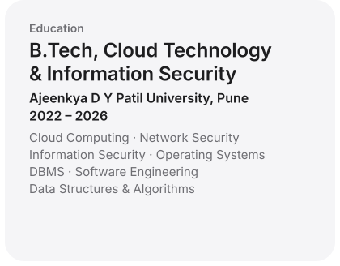</picture><picture><source media="(prefers-color-scheme: dark)" srcset="assets/edu-aws-dark.svg"></picture>

<!-- Contact -->

<picture><source media="(prefers-color-scheme: dark)" srcset="assets/h-motto-dark.svg"></picture>

<h2 align="center"><picture><source media="(prefers-color-scheme: dark)" srcset="assets/h-contact-dark.svg"></picture></h2>

  I'm looking for <b>AI engineering</b> roles: LLM agents, evals, and the cloud and security work that gets them to production. 
  If your team is shipping AI to real users and cares about doing it securely, I'd love to talk.

<a href="mailto:arya.mahindrakar.09@gmail.com"><picture><source media="(prefers-color-scheme: dark)" srcset="assets/cta-email-dark.svg"></picture></a><a href="https://github.com/Arya-9989?tab=repositories"><picture><source media="(prefers-color-scheme: dark)" srcset="assets/cta-repos-dark.svg"></picture></a>

  <a href="mailto:arya.mahindrakar.09@gmail.com">arya.mahindrakar.09@gmail.com</a> 
  <a href="https://github.com/Arya-9989">github.com/Arya-9989</a>
   <a href="https://www.linkedin.com/in/arya-mahindrakar/">linkedin.com/in/arya-mahindrakar</a>

