
<picture><source media="(prefers-color-scheme: dark)" srcset="assets/hero-dark.svg"></picture>

<a href="mailto:arya.mahindrakar.09@gmail.com"><picture><source media="(prefers-color-scheme: dark)" srcset="assets/cta-email-dark.svg"></picture></a><a href="https://github.com/Arya-9989?tab=repositories"><picture><source media="(prefers-color-scheme: dark)" srcset="assets/cta-repos-dark.svg"></picture></a>

<!-- About -->

<h2 align="center"><picture><source media="(prefers-color-scheme: dark)" srcset="assets/h-about-dark.svg"></picture></h2>

I work across the whole path to production: I write the backend, build the pipeline that ships it, run it on AWS, and set up the monitoring and security that keep it healthy. Then I measure the result and make it faster.

<h3 align="center"><picture><source media="(prefers-color-scheme: dark)" srcset="assets/h-what-dark.svg"></picture></h3>

<picture><source media="(prefers-color-scheme: dark)" srcset="assets/cap-1-dark.svg"></picture><picture><source media="(prefers-color-scheme: dark)" srcset="assets/cap-2-dark.svg"></picture><picture><source media="(prefers-color-scheme: dark)" srcset="assets/cap-3-dark.svg"></picture><picture><source media="(prefers-color-scheme: dark)" srcset="assets/cap-4-dark.svg">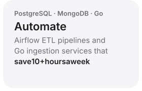</picture><picture><source media="(prefers-color-scheme: dark)" srcset="assets/cap-5-dark.svg"></picture><picture><source media="(prefers-color-scheme: dark)" srcset="assets/cap-6-dark.svg"></picture><picture><source media="(prefers-color-scheme: dark)" srcset="assets/cap-7-dark.svg"></picture><picture><source media="(prefers-color-scheme: dark)" srcset="assets/cap-8-dark.svg"></picture><picture><source media="(prefers-color-scheme: dark)" srcset="assets/cap-9-dark.svg"></picture><picture><source media="(prefers-color-scheme: dark)" srcset="assets/cap-10-dark.svg"></picture>

<!-- Impact -->

<h2 align="center"><picture><source media="(prefers-color-scheme: dark)" srcset="assets/h-impact-dark.svg"></picture></h2>

<picture><source media="(prefers-color-scheme: dark)" srcset="assets/impact-1-dark.svg">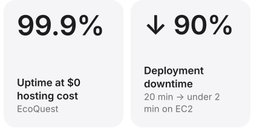</picture><picture><source media="(prefers-color-scheme: dark)" srcset="assets/impact-2-dark.svg">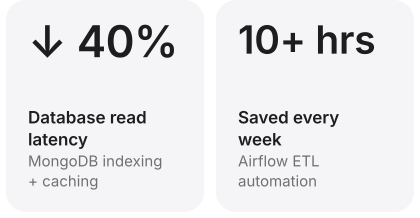</picture>

<!-- Tech stack -->

<h2 align="center"><picture><source media="(prefers-color-scheme: dark)" srcset="assets/h-stack-dark.svg"></picture></h2>

<picture><source media="(prefers-color-scheme: dark)" srcset="assets/stack-1-dark.svg">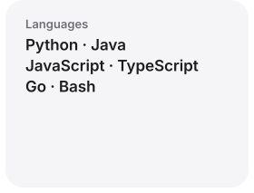</picture><picture><source media="(prefers-color-scheme: dark)" srcset="assets/stack-2-dark.svg"></picture><picture><source media="(prefers-color-scheme: dark)" srcset="assets/stack-3-dark.svg"></picture><picture><source media="(prefers-color-scheme: dark)" srcset="assets/stack-4-dark.svg"></picture><picture><source media="(prefers-color-scheme: dark)" srcset="assets/stack-5-dark.svg"></picture><picture><source media="(prefers-color-scheme: dark)" srcset="assets/stack-6-dark.svg">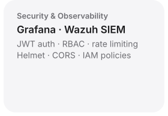</picture><picture><source media="(prefers-color-scheme: dark)" srcset="assets/stack-7-dark.svg">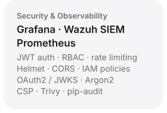</picture><picture><source media="(prefers-color-scheme: dark)" srcset="assets/stack-8-dark.svg">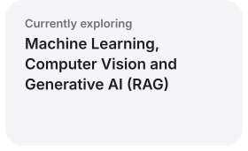</picture><picture><source media="(prefers-color-scheme: dark)" srcset="assets/stack-9-dark.svg"></picture><picture><source media="(prefers-color-scheme: dark)" srcset="assets/stack-10-dark.svg"></picture><picture><source media="(prefers-color-scheme: dark)" srcset="assets/stack-11-dark.svg"></picture><picture><source media="(prefers-color-scheme: dark)" srcset="assets/stack-12-dark.svg">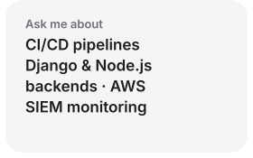</picture>

<!-- Open-source repositories -->

<h2 align="center"><picture><source media="(prefers-color-scheme: dark)" srcset="assets/h-repos-dark.svg"></picture></h2>

<a href="https://github.com/Arya-9989/Autonomous-AI-Software-Engineering-Platform"><picture><source media="(prefers-color-scheme: dark)" srcset="assets/repo-autoswe-dark.svg"></picture></a><a href="https://github.com/Arya-9989/Autonomous-AI-Software-Engineering-Platform"><picture><source media="(prefers-color-scheme: dark)" srcset="assets/repo-autoswe-flow-dark.svg"></picture></a><a href="https://github.com/Arya-9989/SecureCart-Cloud-Native-Security-Enhanced-eCommerce-Platform"><picture><source media="(prefers-color-scheme: dark)" srcset="assets/repo-securecart-dark.svg">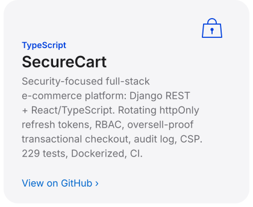</picture></a><a href="https://github.com/Arya-9989/secure-cloud-microservices-platform"><picture><source media="(prefers-color-scheme: dark)" srcset="assets/repo-microservices-dark.svg"></picture></a><a href="https://github.com/Arya-9989/secure-multi-tenant-platform"><picture><source media="(prefers-color-scheme: dark)" srcset="assets/repo-multitenant-dark.svg"></picture></a><a href="https://github.com/Arya-9989/Momentum-Live-Stock-Tracker"><picture><source media="(prefers-color-scheme: dark)" srcset="assets/repo-momentum-dark.svg"></picture></a>

<!-- Featured projects -->

<h2 align="center"><picture><source media="(prefers-color-scheme: dark)" srcset="assets/h-projects-dark.svg"></picture></h2>

### AutoSWE: Autonomous AI Software Engineering Platform
*Flagship AI project · Python · FastAPI · React · Claude AI · Terraform · Kubernetes*

- **Five-agent LLM pipeline** (analyst → architect → coder → DevOps → reviewer) turns a plain-English spec into a downloadable project: FastAPI code and tests, Dockerfile, CI workflow, Kubernetes manifests and Terraform
- Every generated file is **parsed and policy-checked** (paths, secrets, K8s/Docker/CI rules) with an automatic repair pass; generated Terraform and manifests pass `terraform validate` and `kubeconform -strict` in CI
- Async jobs with persisted progress **streamed live over SSE** to a React dashboard; pluggable providers (Claude + a deterministic offline provider so CI runs without API keys)
- Code: [Autonomous-AI-Software-Engineering-Platform](https://github.com/Arya-9989/Autonomous-AI-Software-Engineering-Platform)

### EcoQuest Platform
*React · Node.js · MongoDB · Socket.io · Claude AI*

- Serverless full-stack platform for 3 user roles, reaching **99.9% uptime at zero hosting cost** (Vercel + Render + MongoDB Atlas)
- Real-time Socket.io engine that keeps **50+ live multiplayer game states** in sync with sub-second latency
- **40% lower database read latency** from compound MongoDB indexes and tiered Node-cache TTLs
- **10+ API endpoints with zero vulnerabilities** in simulated payload attacks (JWT/RBAC middleware, rate limiting, strict CORS)
- Claude Haiku engine adapts learning paths across 3 performance tiers, behind a two-layer topic-safety filter

### High-Throughput Analytics Engine
*Go · Docker · PostgreSQL · Apache Airflow*

- Go microservice ingesting **thousands of tracking events per minute with zero data loss**, using PostgreSQL connection pooling
- Fully containerized with Docker, which **eliminated environment drift** for new developers
- Airflow DAGs turn raw logs into query-optimized data marts, **saving 10+ hours of manual reporting every week**

### Multi-Tenant Microservices Architecture
*Python · Django REST · AWS EC2 · Jenkins · Docker*

- B2B Django backend with **100% organization-level data isolation** through query-scoped ORM filtering and strict permission classes
- Declarative **Jenkins CI/CD pipelines** triggered by GitHub webhooks for continuous delivery to staging
- Bash process-management scripts for seamless service swaps on EC2: **deployment downtime cut by 90%**
- Code: [secure-multi-tenant-platform](https://github.com/Arya-9989/secure-multi-tenant-platform): fail-closed tenant isolation, RBAC, expiring invitations and an append-only audit log, with a **228-test suite that attacks every endpoint cross-tenant**
- Code: [secure-cloud-microservices-platform](https://github.com/Arya-9989/secure-cloud-microservices-platform): Django auth service issuing JWTs via JWKS + **Java 21 Spring Boot** orders service behind a Traefik gateway, with Prometheus/Grafana, Trivy-scanned images and a 26-test end-to-end suite in CI

### Infrastructure Observability & SIEM Platform
*Grafana · Wazuh SIEM · Linux*

- Centralized **Grafana monitoring with threshold-based alerting** across virtualized Linux hosts
- **Wazuh SIEM auditing 100% of critical file-integrity events** and unauthorized access attempts, with real-time anomaly detection

### Scalable E-Commerce API Backend
*Django · Python · SQL*

- Order workflows, stateful cart management and secure user authentication
- **30% lower read/write latency** on dynamic product catalogs through data modeling and Django ORM query optimization
- Code: [SecureCart](https://github.com/Arya-9989/SecureCart-Cloud-Native-Security-Enhanced-eCommerce-Platform): Django REST + React/TypeScript storefront and admin console with rotating httpOnly refresh tokens and a **row-locked checkout that can't oversell** (proven by a concurrent-buyers test)

<b>More projects & research</b>

 

| Project | What it is |
| :-- | :-- |
| **[Momentum Live Stock Tracker](https://github.com/Arya-9989/Momentum-Live-Stock-Tracker)** | Global stocks, indices, FX and crypto dashboard with candlesticks, tested technical indicators (SMA/EMA/RSI/MACD/Bollinger), comparison and watchlist (Streamlit · Plotly · yFinance) |
| **Secure Evidence Archiving & Retrieval System** | Tamper-proof digital forensic evidence storage with encryption and audit trails |
| **Ransomware Detection Tool** | Behavior-based detection of encryption malware using anomaly detection |
| **Quantum-Resistant Cloud Encryption** | IEEE-style research paper on post-quantum cryptography for cloud data |
| **Cooling Solutions for Data Centers** | IEEE-style research paper |

<!-- Education -->

<h2 align="center"><picture><source media="(prefers-color-scheme: dark)" srcset="assets/h-edu-dark.svg"></picture></h2>

<picture><source media="(prefers-color-scheme: dark)" srcset="assets/edu-degree-dark.svg">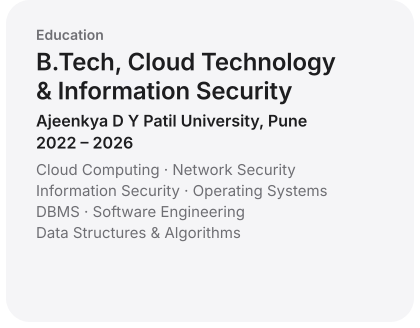</picture><picture><source media="(prefers-color-scheme: dark)" srcset="assets/edu-aws-dark.svg"></picture>

<!-- Contact -->

<picture><source media="(prefers-color-scheme: dark)" srcset="assets/h-motto-dark.svg"></picture>

<h2 align="center"><picture><source media="(prefers-color-scheme: dark)" srcset="assets/h-contact-dark.svg"></picture></h2>

  I'm looking for <b>DevOps, Cloud, Platform and Security engineering</b> roles. 
  If your team ships to the cloud and cares about doing it securely, I'd love to talk.

<a href="mailto:arya.mahindrakar.09@gmail.com"><picture><source media="(prefers-color-scheme: dark)" srcset="assets/cta-email-dark.svg"></picture></a><a href="https://github.com/Arya-9989?tab=repositories"><picture><source media="(prefers-color-scheme: dark)" srcset="assets/cta-repos-dark.svg"></picture></a>

  <a href="mailto:arya.mahindrakar.09@gmail.com">arya.mahindrakar.09@gmail.com</a> 
  <a href="https://github.com/Arya-9989">github.com/Arya-9989</a>
  <!-- Add LinkedIn: replace YOUR-HANDLE and uncomment
   <a href="https://www.linkedin.com/in/YOUR-HANDLE/">LinkedIn</a>
  -->

